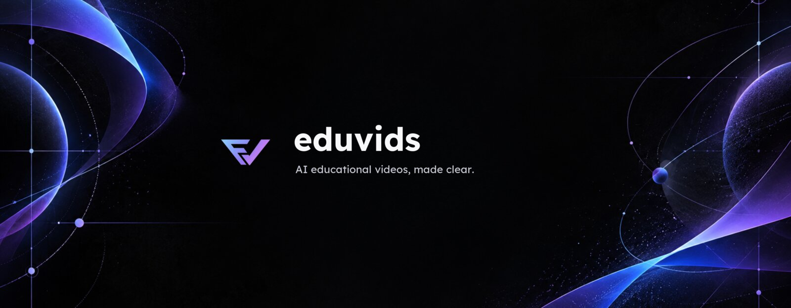

<p align="center">
  <a href="https://eduvids.app"></a>
</p>

<p align="center">
  Type a topic. Get a narrated, animated lesson.
</p>

<p align="center">
  <a href="https://eduvids.app"><b>eduvids.app</b></a> ·
  <a href="https://www.youtube.com/@eduvids-ai">YouTube</a> ·
  <a href="https://x.com/eduvidsai">X</a>
</p>

<br>

<table>
  <tr>
    <td></td>
    <td></td>
    <td></td>
  </tr>
  <tr>
    <td></td>
    <td></td>
    <td></td>
  </tr>
</table>

Every frame above is drawn by code. eduvids plans the lesson, writes the narration, writes [Manim](https://www.manim.community/) scenes for each beat, renders them in a sandbox, and times the voice to the picture. You get back a landscape video or a vertical Short, with a thumbnail.

Free, no sign-in needed. Works in other languages too.

## Run it yourself

You need Node (or Bun), the [E2B CLI](https://e2b.dev/docs/cli), and accounts for the services below.

```bash
git clone https://github.com/namanbnsl/eduvids
cd eduvids
bun install
```

Build the render sandbox once:

```bash
cd sandbox-templates/eduvids-render
npm install e2b
E2B_API_KEY=... npm run e2b:build:prod
```

Copy `.env.example` to `.env` and fill it in:

| | |
| --- | --- |
| `GOOGLE_GENERATIVE_AI_API_KEY_1` | [Google AI Studio](https://aistudio.google.com/) — writes the lesson and the code. `_2`, `_3` are optional spares. |
| `E2B_API_KEY` | [E2B](https://e2b.dev) — renders the video |
| `CONVEX_DEPLOYMENT`, `NEXT_PUBLIC_CONVEX_URL` | [Convex](https://convex.dev) — chats and videos |
| `QSTASH_*` | [Upstash](https://upstash.com) — runs the render workflow |
| `KV_*` | Upstash Redis — job state |
| `UPLOADTHING_*` | [UploadThing](https://uploadthing.com) — stores finished videos |
| `NEXT_PUBLIC_CLERK_*`, `CLERK_*` | [Clerk](https://clerk.com) — accounts |

Optional: `GROQ_API_KEY` for Groq-backed chat and topic generation, `DEEPGRAM_API_KEY` or `OPENROUTER_API_KEY` for a better English voice (falls back to gTTS), PostHog for analytics, and the YouTube and X keys for auto-posting.

```bash
bun run dev
```

Open [localhost:3000](http://localhost:3000).

<details>
<summary>Auto-upload to YouTube</summary>

<br>

1. In Google Cloud Console, create an OAuth client of type *Desktop app*. That gives you `GOOGLE_CLIENT_ID` and `GOOGLE_CLIENT_SECRET`.
2. Put them into `helper/get_google_refresh_token.mjs`, then run it and approve access for your channel:

   ```bash
   node helper/get_google_refresh_token.mjs
   ```

3. Copy the printed token into `GOOGLE_REFRESH_TOKEN`.
4. Set `YOUTUBE_PRIVACY_STATUS` to `public`, `unlisted` or `private`, and optionally `YOUTUBE_PLAYLIST_ID`.

</details>

<details>
<summary>Auto-post to X</summary>

<br>

Create an app in the X developer console and add its keys to `.env`.

</details>

## How it looks, and why

The design notes live in [`docs/`](docs), each with before/after renders and the scripts to reproduce them:

- [Visual storytelling](docs/visual-storytelling) — show the idea, not a slide about it
- [Video quality](docs/video-quality) — composition, labels, 3D
- [Thumbnail layout](docs/thumbnail-layout)
- [Render performance](docs/render-performance)

## Contributing

Issues and pull requests are welcome. If a video came out wrong, open an issue with the prompt — that's the most useful bug report there is. See [CONTRIBUTING.md](CONTRIBUTING.md) for setup, tests and PR guidelines.

## License

[MIT](LICENSE)
