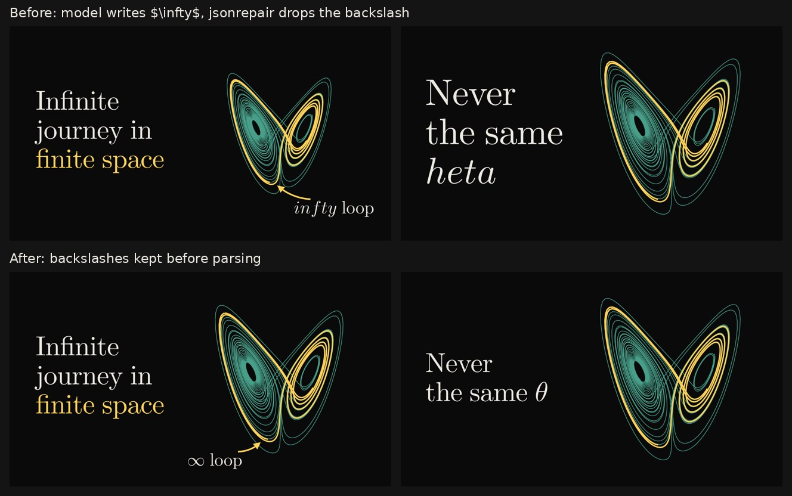
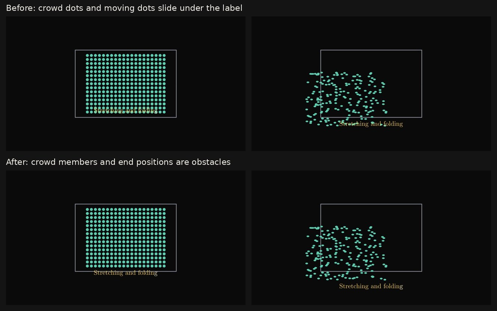
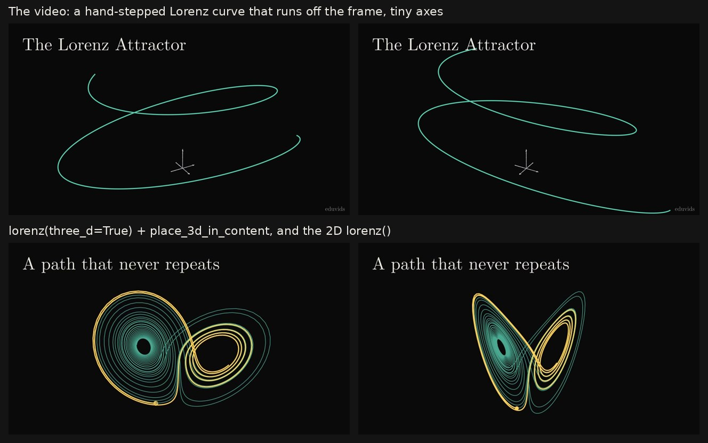
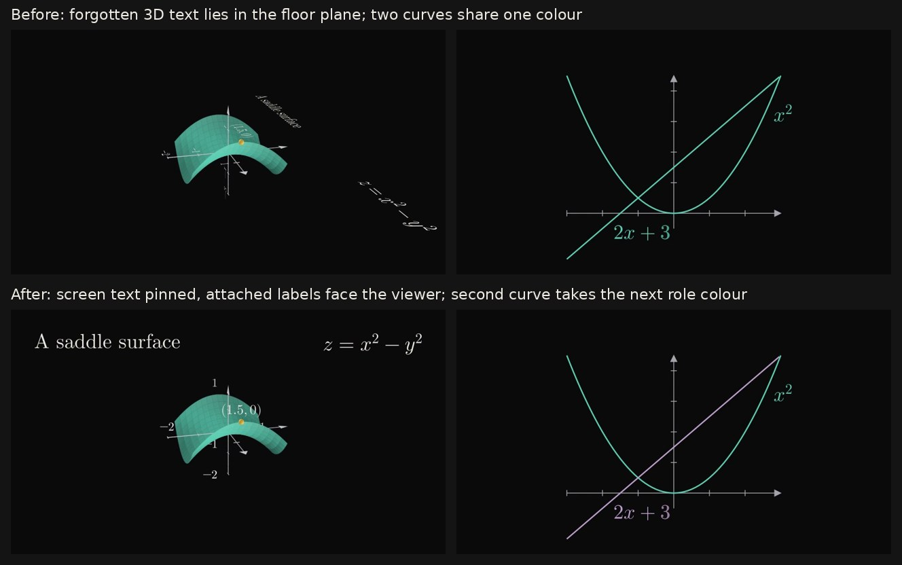

# Chaos video review

A generated video on the Lorenz attractor ("Infinite journey in finite
space") showed four kinds of fault. Each one traced back to the
pipeline, not just to this video's script.

## Thumbnail: "*infty* loop" instead of "∞ loop"

The packaging model writes LaTeX into JSON with a single backslash
(`"callout": "$\infty$ loop"`). `\i` is not a valid JSON escape, and
`jsonrepair` fixed it by dropping the backslash, so TeX received `$infty$`
and set the letters in math italic. The same parse quietly broke other
commands. `\theta` became a tab and "heta", and `\frac` became a form feed
and "rac".

- `src/lib/latex-json.ts` doubles the lone backslash before a LaTeX
  command in the raw model output before it is parsed. That covers the
  title/thumbnail packages, the description package and the scene plan.
  Real `\n` escapes are kept: a backslash before `b f n r t u` is doubled
  only when the letters name a known command.
- The TypeScript and Python LaTeX sanitizers reject control characters
  (a lost `\t` or `\f`) and collapse `\\infty` (a TeX line break before
  "infty") to `\infty`.

## Labels on top of dots

"Stretching and folding" was drawn over the particles it described.
The layout guard had two blind spots:

- `crowd()` is one unstroked, filled path, so the guard saw no obstacle
  at all. Each crowd member is now an obstacle, but the gaps between
  members are not.
- In `self.play(dots.animate.stretch(...), Write(label))` the guard only
  saw where the dots started. Where objects moved by `.animate` or
  `MoveToTarget` end up is now in the way too.

## The Lorenz attractor itself

The planner chose a 3D scene, and the `lorenz()` helper was 2D-only, so
the animator stepped the equations itself. The result was a few loose
ellipses in raw units, with tiny `ThreeDAxes`, and the curve ran off the
frame. The thumbnail promised the butterfly, and the video never showed
it.

- `lorenz(three_d=True)` keeps the trajectories' depth, centres the
  attractor and sizes it for `place_3d_in_content`, which keeps it between
  the title and the frame edge through the planned orbit.
- The scene planner names signature visuals as props. The animator prompt
  shows the 3D form and forbids hand-built stand-ins (stepping the
  equations, ellipses, ribbon surfaces).
- `scenePlanVisualGaps` adds an animator note to any scene whose storyboard
  or elements show an attractor, golden spiral, prime spiral, Sierpinski
  triangle, Koch snowflake or fractal tree, naming the exact helper. A
  scene about the Lorenz *equations* gets no note.

## Text lying flat in 3D scenes, and curves that share a colour

In a ThreeDScene, a Text or MathTex the script forgot to register with
`fixed_overlay` / `add_fixed_orientation_mobjects` was drawn in world
space. It lay in the floor plane and turned edge-on as the camera moved.
The guard now handles each piece of 3D text when it enters the scene:

- Screen text is fixed in the frame: titles, captions, and a formula in
  a corner or side column, far from the 3D picture.
- Text attached to the picture keeps its world position and always faces
  the viewer: axis numbers, labels above the floor plane, and labels
  next to 3D geometry.
- An explicit call in the script still wins. Fixing an object one way
  now removes it from the other set, because Manim's
  `add_fixed_orientation_mobjects` adds the label before it registers it.

When a new curve (`axes.plot`, any ParametricFunction) arrives in the
colour of a curve already on screen, it takes the next free role colour
(PRIMARY, SECONDARY, then TERTIARY). So does a label of the old colour
that sits on the curve, such as `get_graph_label`. A curve morphing into
another and faint ghosts are left alone. The prompts now ask for one role
colour per graph, with each equation in its curve's colour.

## Not changed

- The end card ("Watch next: Why Carbon Builds All of Organic
  Chemistry") is the channel's previous upload, by design, so it is not
  related to the topic.
- The ~0.8 s blank frames between scenes are the scene fade-out and
  fade-in.

## Tests

- `tests/youtube-metadata.test.ts`: single-backslash LaTeX survives the
  parse, real `\n` escapes are kept, and `\\infty` is collapsed.
- `tests/video-quality.py`: labels clear crowd members and the end state
  of moving geometry, and the 3D Lorenz keeps its depth and stays between
  the title and the frame edge through a 20° orbit. All three fail on the
  previous style module.
- `tests/video-quality.py`: forgotten 3D text is pinned to the frame or
  faces the viewer, and an explicit fixing call still wins. A second
  graph and its label take a new colour, but a morph or a ghost does not.
- `tests/reliability.test.ts`: the signature-visual note fires for an
  attractor scene, but not for an equations scene.
