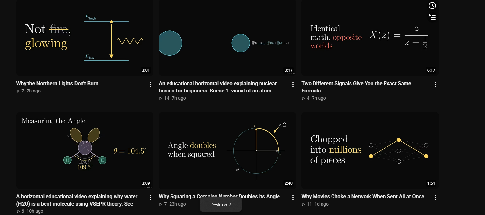
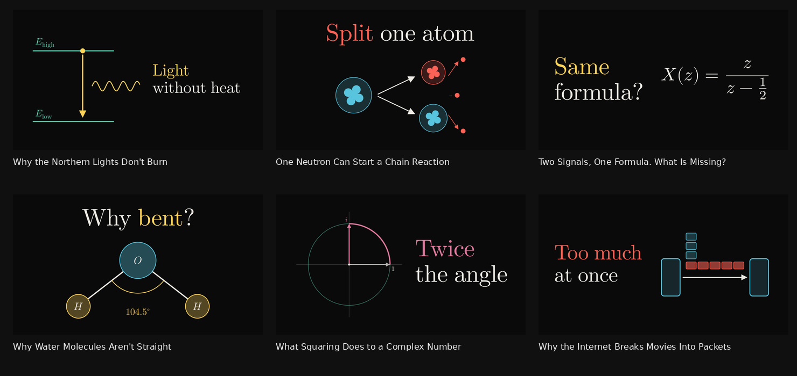

# Video packaging quality

The supplied channel screenshot shows production briefs published as titles,
a visually repetitive grid, and subject-specific images reduced to tiny or
generic diagrams.

Before (supplied screenshot):



After (production renderer, representative fixtures for the same six topics):



The after image uses hand-authored title/concept fixtures to make layout and
subject coverage reproducible without paid APIs. It does not represent a live
model evaluation, a CTR experiment, or updates to existing uploads.

## Changes

- Headline thumbnails vary between text left, text right and a top-headline
  poster. A stable job seed rotates the published A composition across videos;
  C uses a different composition, and B remains text-free. Every layout uses
  the existing collision, safe-area and duration-badge checks. Legacy specs
  without a layout retain text on the left.
- Nuclear fission, water/CO2 molecular geometry and queued network packets have
  their own diagrams instead of generic atomic or neural-network icons. Water's
  bonds are drawn at 104.5 degrees, with a single matching angle label. Fission
  and packet traffic are schematic and make no isotope or traffic-count claims.
- Strike-throughs and arrows are optional in the packaging prompt. The prompt
  asks for different title openings and source-grounded, complementary copy.
- Title generation rejects production directions and duplicate candidates
  regardless of case. Production generation also requires complete concepts,
  valid A/C headlines and usable equation/number/molecule parameters.
- Title and description generation each get one repair attempt, including
  validation feedback. Invalid description JSON never becomes public copy;
  description hooks must have two short viewer-facing lines.
- If generation remains unavailable, upload titles extract a short topic from
  the brief, removing format and scene directions. The description fallback
  uses that topic and a neutral animation summary rather than fabricated claims.

This applies to newly generated uploads. Source grounding still depends on the
model; render validation checks geometry and syntax, not scientific truth.

## Reproduce

Requires Manim, XeLaTeX, dvisvgm and Pillow, with the bundled fonts:

```sh
python3 docs/packaging-quality/render-review.py
python3 tests/thumbnail-layout.py
npm test
npm run check
```

Metadata regression tests exercise the supplied fission/water brief patterns,
malformed and oversized descriptions, bounded repair, deterministic composition
variation and topic-specific fallback visuals. Geometry tests cover all four
layouts for all six review subjects plus CO2, in full and safe modes, and verify
the drawn water bond angle.
