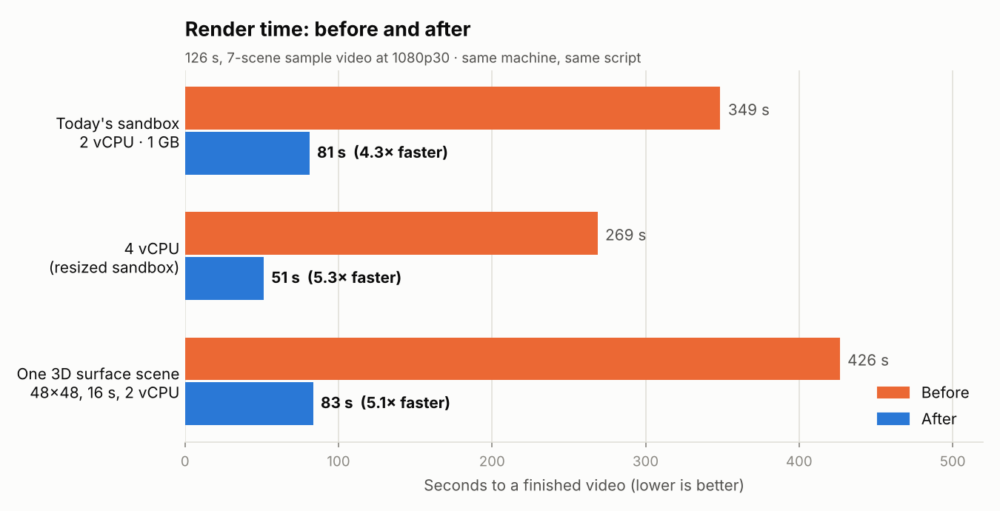
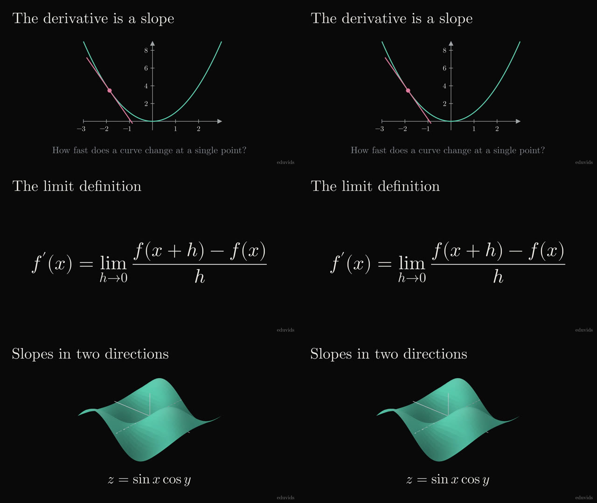

# Render performance

Measured with `scripts/bench/harness.ts`. It runs the real prepare, render job
and postprocess code on a seven-scene, 126 s, 1080p30 sample video
(`scripts/bench/sample-video.py`): graphs with live readouts, formulas,
geometry and a lit 3D surface. Narration uses tone clips of realistic length.
Before is `696bf4e` (main). Both sides ran on the same machine.

| Setup | Before | After |
| --- | --- | --- |
| Today's sandbox (2 vCPU, 1 GB) | 348.7 s | 81.0 s (4.3×) |
| 4 vCPU | 268.7 s | 51.1 s (5.3×) |
| One 48×48 lit surface scene, 16 s (2 vCPU) | 426.5 s | 83.4 s (5.1×) |
| Memory per render process | 0.75–1 GB | ~210 MB, plus ~180 MB shared |
| Script error raised during an animation | hung until the 30 min job timeout | fails in ~3 s |

The 2 vCPU run gives the driver 850 MB of free memory, which is what a 1 GB
sandbox leaves. It fits two renders at once if at least ~670 MB is free; with
less it renders one at a time.

The production template builds with the E2B SDK defaults (2 vCPU, 1 GB). It now
asks for 8 vCPU / 8 GB, which takes effect once the template is rebuilt:
`npm run e2b:build:prod` in `sandbox-templates/manim20-ffmpeg-bookmarks-latest`.
Set `E2B_TEMPLATE_CPU_COUNT` and `E2B_TEMPLATE_MEMORY_MB` to match your plan.
The driver uses whatever the sandbox has.

## Same picture

Left is before, right is after, at 12 s, 50 s and 100 s of the final videos.
Across every frame of the two videos PSNR averages 57 dB, with the worst frame
at 50 dB.

- The drawing changes are pixel-identical to Manim's own drawing. That covers
  the 3D batching, depth sort, axis shading, path building, canvas reset and
  family walks. Checked over four camera angles and several surface types, and
  over thousands of decoded 2D frames.
- Handing frames to the encoder without a copy, and converting held frames
  once, decodes identically.
- Encoding is x264 superfast at CRF 16 without B-frames, instead of medium at
  CRF 18. Against a lossless render the quality matches (SSIM 0.99982, PSNR
  60.5 vs 59.8 dB). Files are about twice the size, ~0.9 Mbit/s.
- Narration lands 21 ms earlier than before, i.e. on time. Scene audio is now
  stored losslessly, which drops AAC's 1,024-sample encoder priming; Manim
  muxed that priming without an edit list.
- Split scenes join with the same frames, timestamps and sounds as a whole
  render (`tests/render-segments.py`).

## Where the time went

| Change | Effect |
| --- | --- |
| Batched 3D lighting, projection, depth sort and drawing | A lit surface spent most of each frame in per-patch Python |
| ThreeDAxes shading computed once per frame | It walked each axis ~200 times a frame |
| Faster `get_family`, path building and canvas reset | Same results with less Python per frame; 2D scenes ~30% faster |
| Frames handed to x264 without a copy; held frames converted once | Frame conversion 4× faster |
| x264 superfast, CRF 16, no B-frames | Half the encoder CPU, ~75 MB less per render, same quality |
| Bounded frame queue | Manim could queue ~1 GB of 8 MB frames |
| Renders forked from a server that has already imported Manim | No ~2 s import per scene; shared memory lets two renders fit 1 GB |
| One process per scene, longest first; long scenes split by frame range | Cores stay busy; a 3D camera move no longer holds up the video |
| `--silent` | Manim asked PyPI for its latest version after every render (10 s timeout) |
| Lossless scene audio | AAC per scene was 5× the cost and added a 21 ms lag |
| Postprocess inside the render job | One launch and poll fewer; scene audio decodes in parallel |
| Poll every 2 s on one connection | A finished job waited up to 10 s to be noticed |
| Titles, description and thumbnails during the render | They used to wait for the upload |
| Parallel steps and fewer round trips before the render | Language, scene plan and previous video run together |
