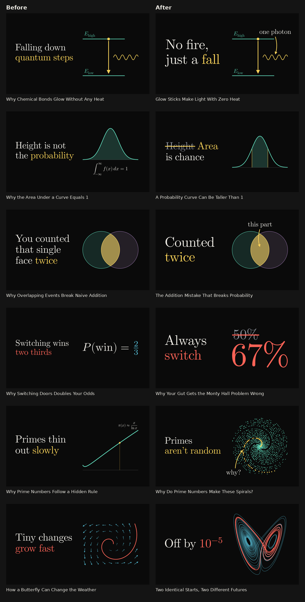
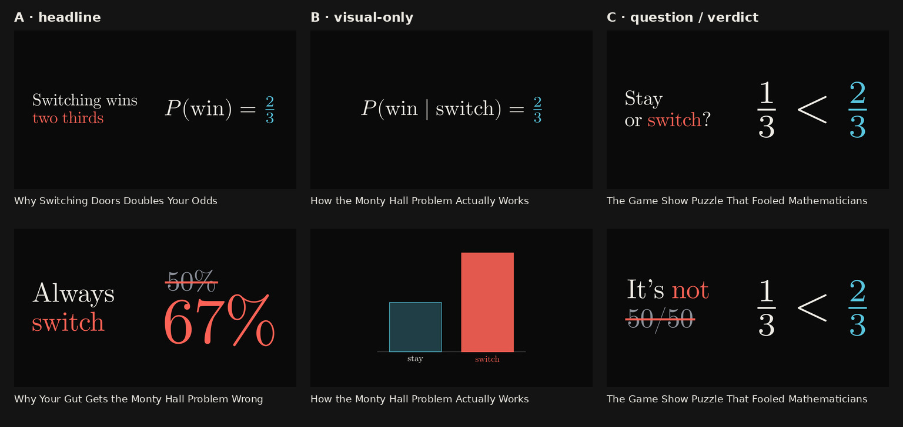
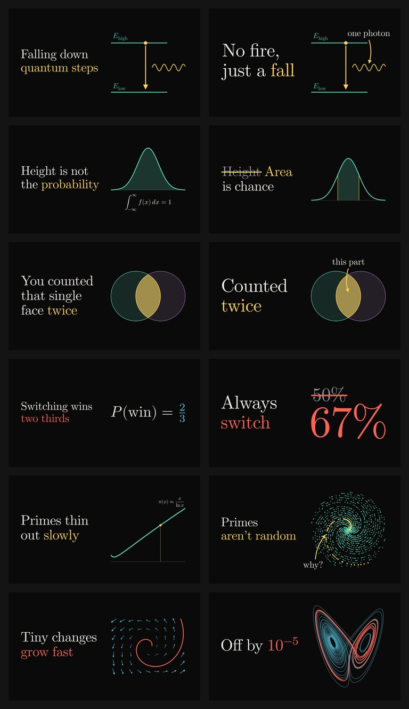

# Thumbnail and title click-through review

Same topics, same house style (flat near-black canvas, Computer Modern,
one cool hue for the visual and one warm hue for the payoff). Left is
the renderer and packaging rules on `main`; right is this branch.



## What changed

**Copy devices**

- **Strike-through correction.** One word, number or `$math$` token of
  the headline can be drawn muted under a warm rule: the wrong intuition
  the video breaks (`~~Height~~ Area is chance`, `It's not ~~50/50~~`).
  It is typeset in TeX, so kerning and baselines match the rest of the
  line. It is never the accent and never part of a word.
- **Callouts.** Headline slots can add 1-3 words beside the hero, with a
  curved warm arrow to the hero's focal detail ("this part", "why?",
  "one photon"). Every hero now declares its focal point. The callout is
  placed only in clean space (no strokes, fills, labels, copy block or
  duration badge). If no scale leaves room, it is dropped and the fit is
  redone without it, never forced.
- **Bigger type for short copy.** Two new headline tiers (124, 108 px).
  The prompt now asks for 2-5 words, so short headlines like "Counted
  twice" or "Always switch" set about 35% larger than before. That is the
  text that still reads on a phone.

**New hero visuals** (all data in, verified geometry out)

| Type | Shapes | For |
| --- | --- | --- |
| `spiral` | `golden`, `primes` | Fibonacci squares under the golden spiral; primes at (p, p rad) falling into spiral arms |
| `chaos` | `lorenz`, `pendulum` | Two starts 10⁻⁵ apart peeling away; two double pendulums released together, now apart |
| `fractal` | `sierpinski`, `koch`, `tree` | Self-similarity with one warm copy, infinite edge, recursive branching |
| `bars` | values, focus, labels | Real data from the narration (Benford, stay vs switch) with the surprising bar warm |
| `number` | value, was | One giant figure, with the intuitive wrong figure struck through above it |



**Titles.** The packaging prompt now aims explicitly at click-through.
The model mines the narration for its puzzle, wrong answer and most
surprising number, brainstorms ten or more ideas from different angles,
then keeps the three strongest (`{"ideas": [...], "packages": [...]}`;
the parser still accepts the old bare array). It asks for curiosity gaps
anchored to something concrete, says when to use the strike and callout
devices, and asks slot B (visual-only) for the single most arresting
image. "Never promise what the narration doesn't deliver" and "never
invent numbers or data" still hold.

At phone size (360 px wide, roughly the YouTube mobile feed), the larger
copy and denser heroes carry much better:



## Caveats

- The packages here are hand-written fixtures: the "before" ones follow
  the old prompt's rules and visual set, the "after" ones follow the new
  prompt. They are not live model output (no API keys were used), so they
  show what the system can now express, not measured CTR. The real test
  is the existing A/B/C slot rotation on YouTube.
- Slot B stays text-free: callouts and strikes are stripped there in
  both TypeScript and the renderer.
- Every new field is validated twice: by the TypeScript sanitizers and
  again in `renderer.py`. Bar labels and figures use restricted character
  sets, and callouts use the headline grammar.

## Reproduce

```sh
python3 docs/thumbnail-ctr/render-review.py   # before renderer is read from git (444735f)
python3 tests/thumbnail-layout.py
npm test
npm run check
```
