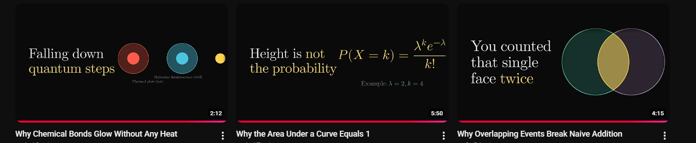
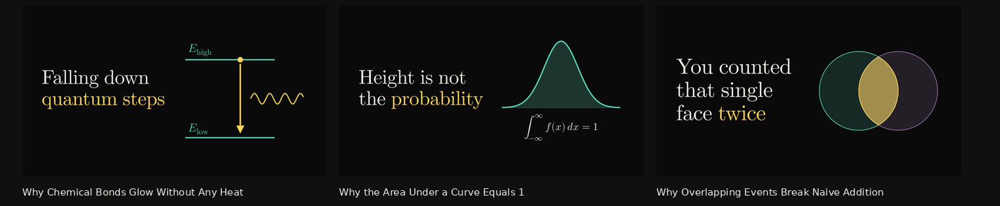

# Thumbnail layout review

The before image is the supplied screenshot of three different videos.
The after images are representative specs rendered by the production
renderer, using the same topics and headline copy. They demonstrate the new
generation path; existing YouTube uploads have not been changed.

| Before | After |
| --- | --- |
|  |  |

1. **Chemical glow:** two aligned energy levels, a visible downward
   transition and emitted light replace the spaced-out discs and tiny prose
   legends. The short energy labels stay attached to their levels at a fixed
   readable size.
2. **Probability:** a shaded continuous distribution and its normalization
   integral replace the unrelated discrete Poisson formula. The curve is cool,
   the equation is neutral and only the headline payoff is warm.
3. **Overlap reference:** the simple circles and warm intersection retain
   the visual style of the right-hand example. A supported Venn diagram now
   makes this composition available without importing a video frame.

All three thumbnail slots use their validated concept visual. Video frames
previously replaced the first two concepts regardless of subject, carrying
video labels and formula colours into a space where the renderer could not
check them. Legacy explicit frame specs still render, but production no longer
picks or injects them. The visual-only middle candidate remains visual-only.
These fixtures each represent a headline thumbnail from a different video,
not the three candidate slots for one video.

Equation heroes retain neutral glyphs and use cool `\hl{...}` highlights,
separate from warm headline accents. The packaging prompt requests a short
focal term, avoids whole-formula highlights and captions, and chooses an area
diagram for continuous probability rather than a discrete probability formula.
Subject accuracy still depends on the generated concept and source material;
the renderer validates geometry and notation, not mathematical meaning.

## Reproduce

```sh
python3 docs/thumbnail-layout/render-review.py
python3 tests/thumbnail-layout.py
npm test
npm run check
```

Rendering requires Manim, XeLaTeX, dvisvgm and Pillow. Fonts are bundled.
The regression checks compile actual glyphs and verify equation colours,
relation spacing, energy-label sizes, and collision-free layouts in both full
and safe modes. The sandbox workflow check verifies that video availability
cannot replace the selected concept visual.
