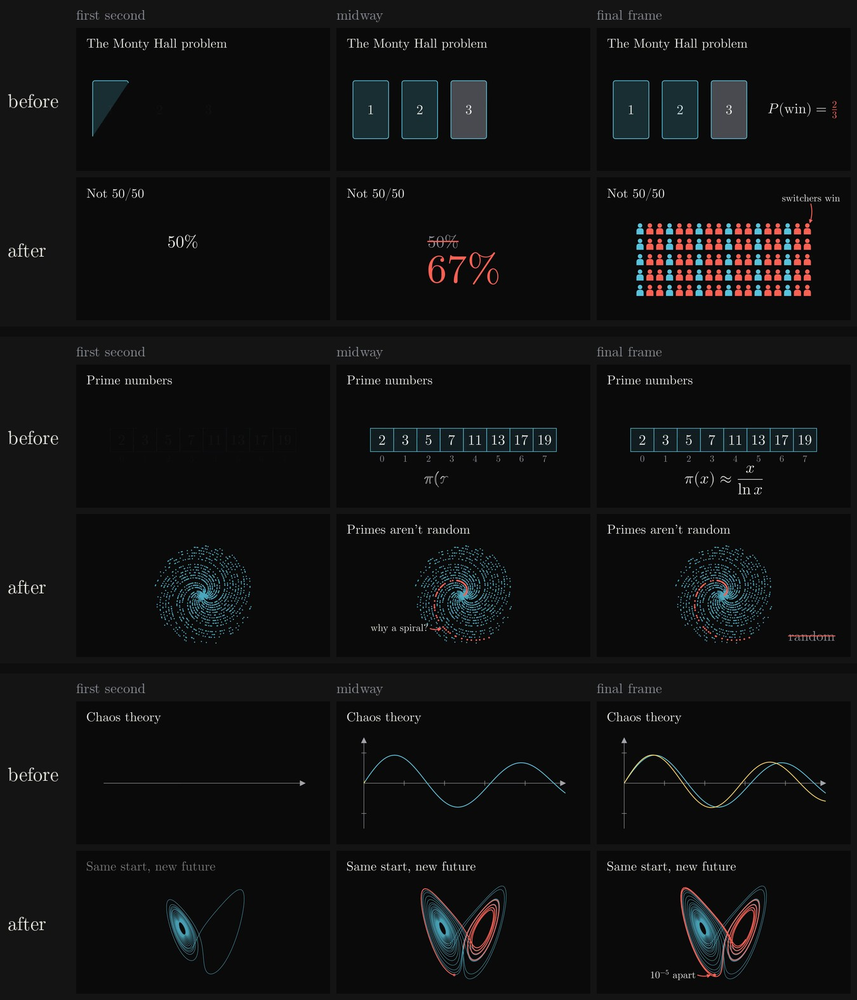

# Video engagement review

The videos now use the same devices as the thumbnails, so the frame a
viewer clicked on is paid off in the first seconds. Each row below is the
same topic animated twice with this branch's house-style module and
palette. "Before" follows the old prompt rules with devices that already
existed (equation_link, cells, a plain plot). "After" follows the new rules.



Whole scenes, before on the left and after on the right:

| Monty Hall | Prime spirals | Chaos |
| --- | --- | --- |
|  |  |  |

## The rules (scene planner and animator prompts)

- **Hook picture first.** Scene 1 opens on the topic's most striking
  image within the first second (a signature visual, crowd, zoom or big
  number), never a title card or an empty axis.
- **Correction beats.** Wherever the narration names the tempting wrong
  answer, it appears on screen and is struck out in ACCENT, then the right
  answer arrives: `correct(guess, answer)` or `strike(word)`.
- **Big numbers.** The payoff figure can be the hero of its beat:
  `big_number(r"67\%", was=r"50\%").reveal()`.
- **Pointers.** `point_at(detail, "this part")` gives a few words and a
  curved ACCENT arrow to the one surprising detail, as on the thumbnail.
- **Signature visuals.** `prime_spiral`, `golden_spiral`, `lorenz`,
  `sierpinski`, `koch` and `fractal_tree` render exactly and cheaply. Dots
  and triangles are single paths, so thousands of them cost one draw call.
- **Claim titles.** Scene titles state the tension ("Not 50/50"), not the
  topic ("The Monty Hall problem").
- A full video plans at least one correction or big number and two or
  more engagement beats. The deterministic plan check adds notes for the
  animator when the opening is flat or no engagement beat is planned.
- The narration prompt now says the guess out loud as a short phrase that
  can be struck, and lands on one figure or image.

These scenes are hand-written to each rule set; they are not model output.

## Reproduce

```sh
python3 docs/video-engagement/render-review.py
```
