# Video quality review

These are reproducible Manim renders, with actual text, math and geometry.
The baseline uses the shipped house-style module at `4de946a` (PR #12).
Both sides render at 1920×1080 so the comparisons isolate composition and
material changes. Production previously defaulted to 1280×720; it now uses
1920×1080 at 30 fps, or 1080×1920 for Shorts, with CRF 18 encoding.

## Grouped labels: identical scene code

The old guard only checked standalone text. A label inside a graph group
could overlap its curve, even though the render succeeded. The new guard
walks mixed groups, sees geometry arriving in the same `add` or `play`,
and reserves the entire text rectangle rather than individual glyphs.

| Before | After |
| --- | --- |
| 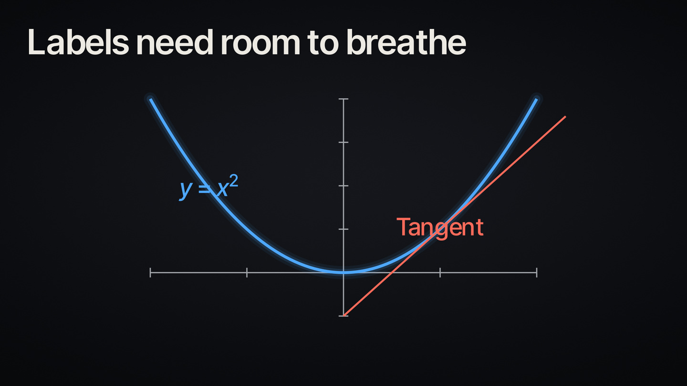 | 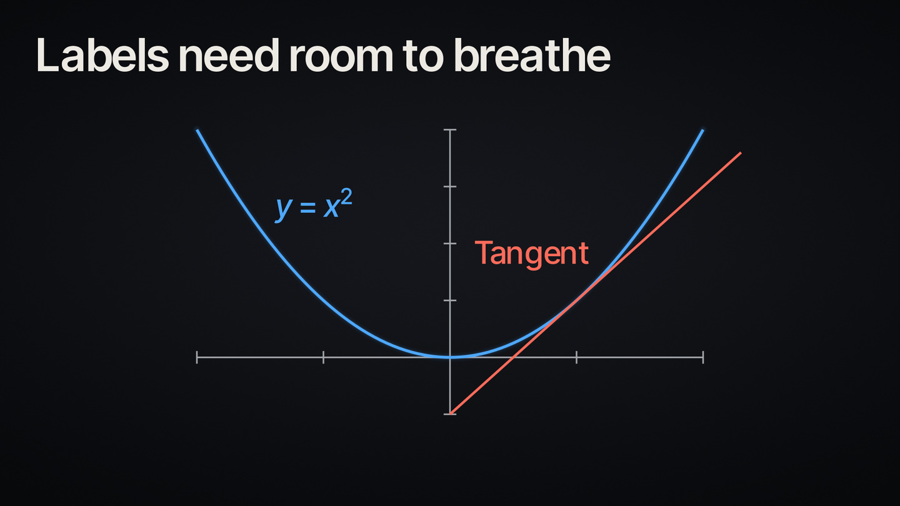 |

## Graph: explicit composition and aligned annotations

The previous prompt fitted the graph first and positioned annotations
afterwards. The revised template reserves title, graph, equation and caption
lanes together, keeping the equation block aligned during progressive reveals.
The point, tangent, and numeric readout still follow the same function.

| Before | After |
| --- | --- |
| 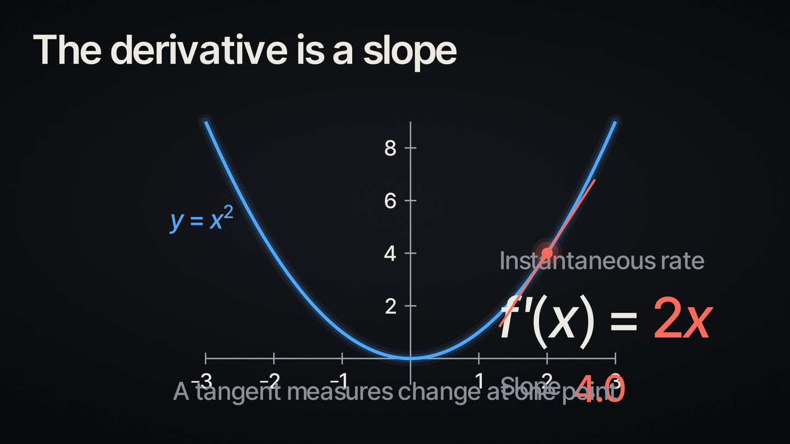 | 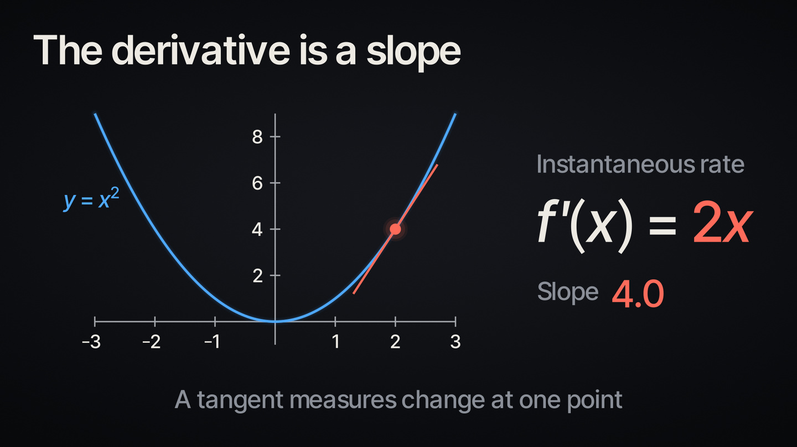 |
| 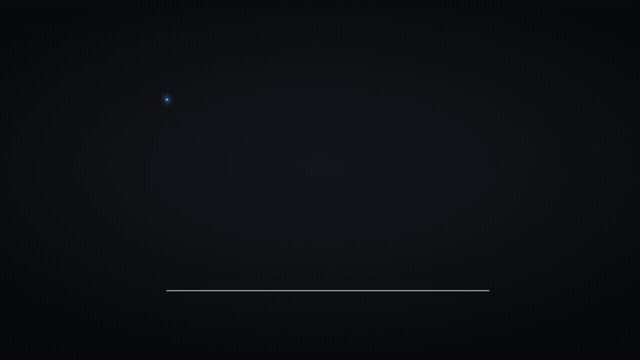 | 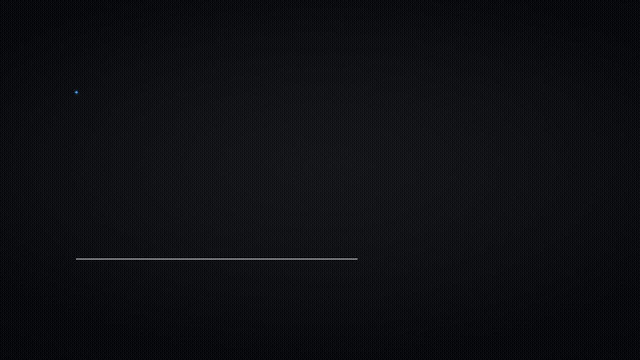 |

## 3D: smooth material and a bounded, fitted camera move

The old surface shows a contrasting outline around every patch. The new
material uses shared corner normals, restrained highlights, and matching
seams to close Cairo anti-alias gaps. Three meaningful coordinate slices
replace thousands of patch outlines. The revised scene fits the projected
silhouette over its planned 16° orbit and reserves the formula below it.
Screen overlays register before their reveal without being added early.

| Before | After |
| --- | --- |
| 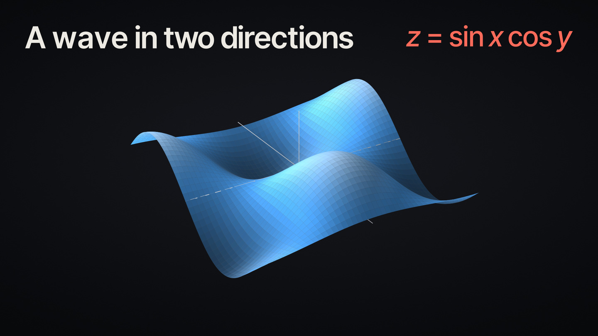 | 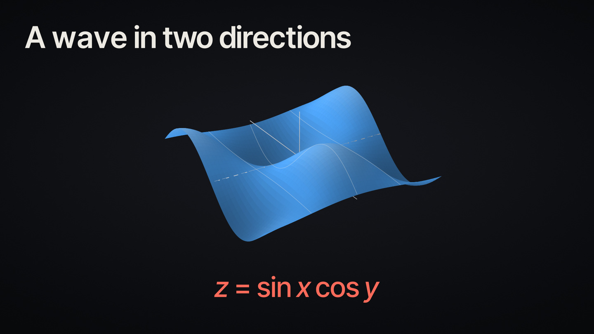 |
| 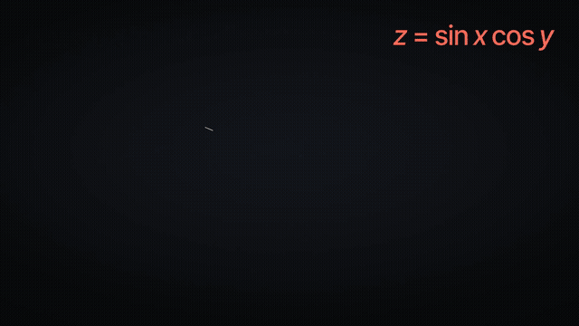 | 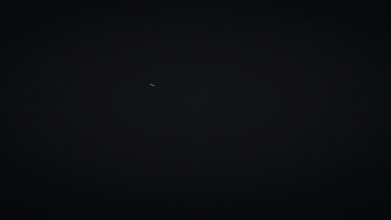 |

## Portrait

The same template stacks the equation below the graph rather than squeezing
landscape columns into a narrow frame. Projection fitting also accounts for
the portrait title and formula lanes.

| Graph | Surface |
| --- | --- |
| 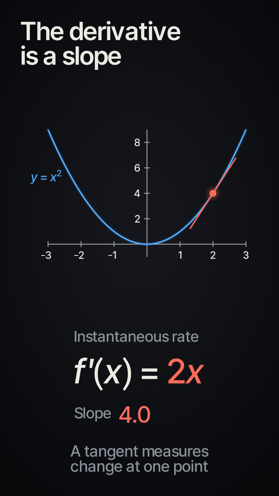 | 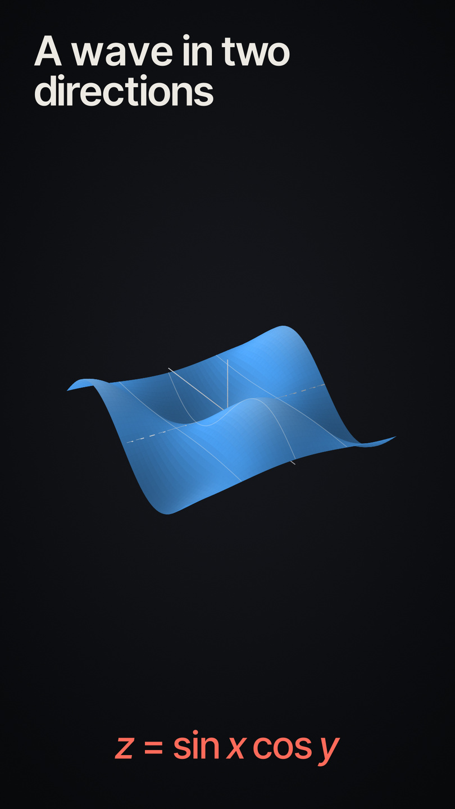 |

## Reproduce and validate

```sh
python3 docs/video-quality/render-review.py
npm test
npm run check
```

Manim 0.20, XeLaTeX, dvisvgm and ffmpeg are required for renders and geometry
tests. The render script uses bundled fonts and no narration or paid APIs.
Full MP4s stay under the printed `/tmp` directory; PNGs and compact GIFs are
copied here (review stills are resized to 1440 pixels on the long edge). `--stills-only` skips motion renders. The eight layout/material
regressions plus an encoder check run through `tests/reliability.test.ts`.

These are representative fixtures, not regenerated user videos. Existing
published MP4s are unchanged. New renders use the runtime fixes even on old
scripts; the new composition helpers also depend on the revised generator
prompt. Moving/updater-owned annotations keep their anchors, and camera
scenes with a moving 2D frame retain their own positioning. The static guard
logs a warning if it cannot find a clear position; it does not promise to
repair arbitrarily crowded or continuously moving diagrams. Higher resolution
and denser surfaces increase render cost; the driver reserves more memory per
process to reduce oversubscription.
