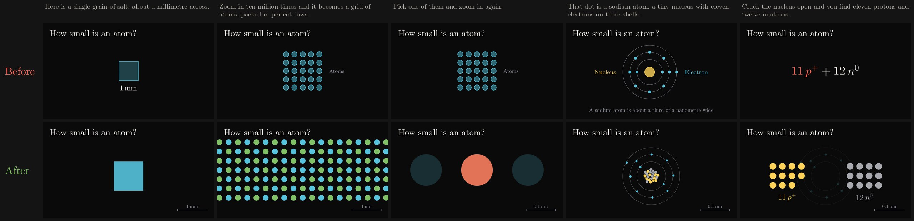
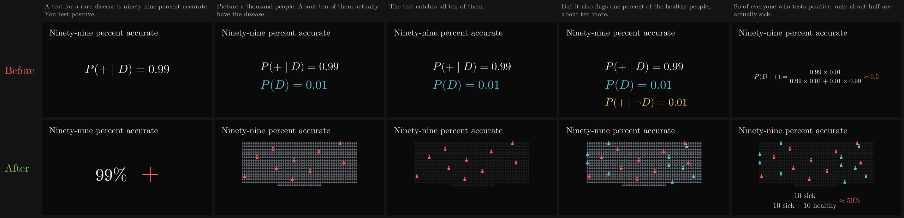
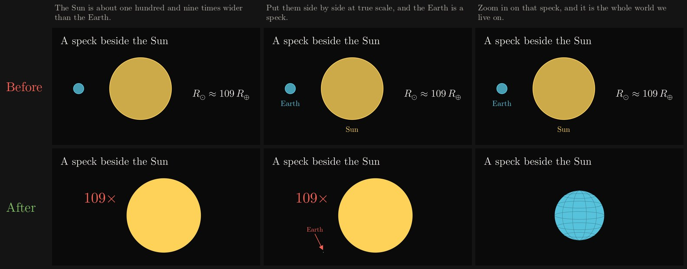
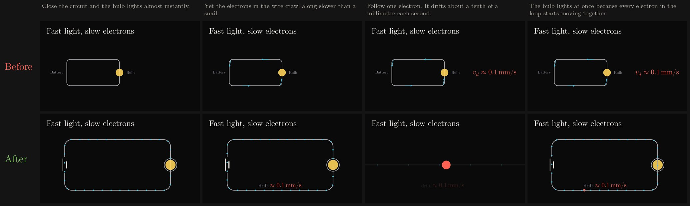
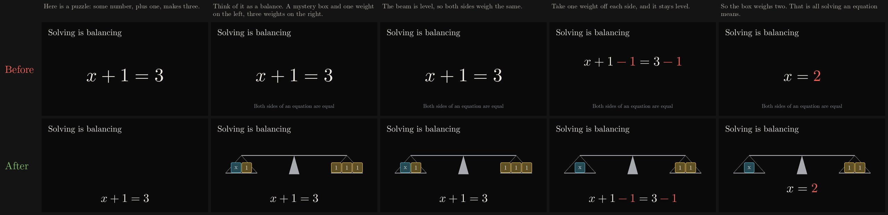
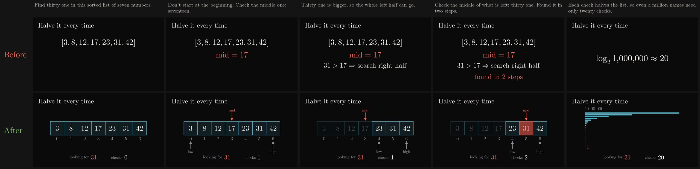
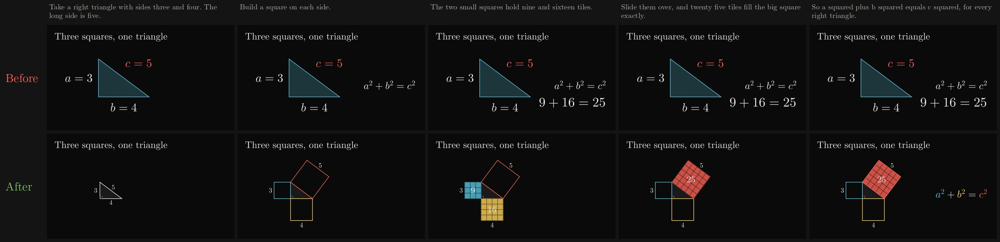
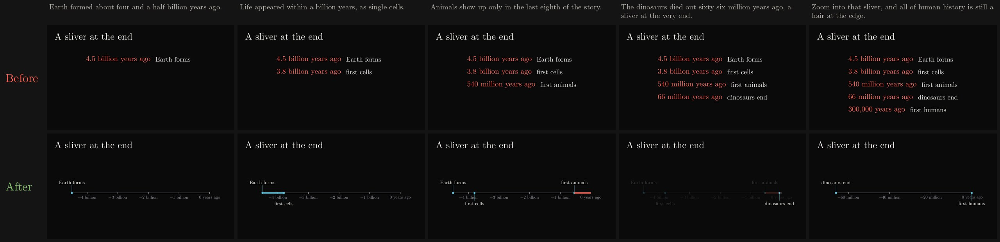
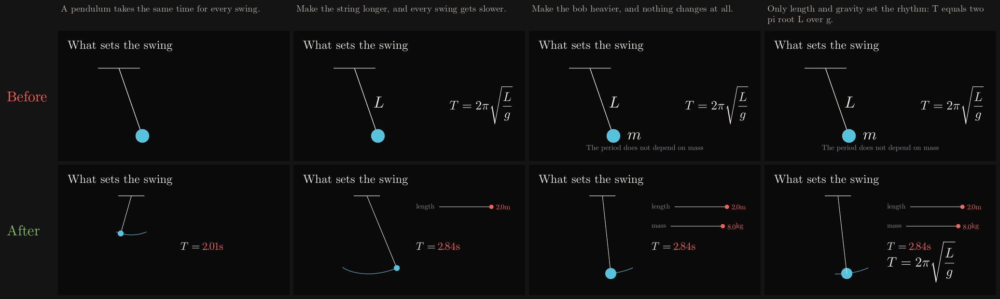

# Visual storytelling review

Nine topics across subjects. Each pair uses the same narration. **Before** is written to the previous
prompt's templates: header, `layout_scene`, a hero formula, `pop_in` and
`pulse`. **After** is written to the new prompt's visual devices and
helpers. Both use the current house style, so fonts, palette and canvas are
identical. The only difference is how the idea is shown.

These scenes are representative fixtures, not regenerated user videos. They
were written by hand to each prompt's instructions, because no generation
model or API key was available here. Production output also depends on how
well the generator follows the new prompt.

## Atom: a population first, then one, then inside it

A grain of salt dissolves into a sodium–chlorine lattice of 2,400 atoms. The
view zooms into one atom while the scale bar goes from 1 mm to 1 nm to
0.1 nm. The atom's neighbours dim, and the dot opens into a sodium atom
with 11 electrons on three shells. Its nucleus then sorts itself into
11 protons and 12 neutrons.




## Bayes: make "out of N" countable

The before version is a chain of conditional probabilities. The after
version shows 1,000 people. The 10 who are sick light up and are all
caught, and then 10 healthy false positives join them, so the 50% answer
is something you can count.




## Sun: true scale, then zoom into the speck

The Earth is drawn at 1/109 of the Sun's width, a speck you need an arrow
to find. The view then zooms into that speck until it becomes the globe.




## Circuit: follow one particle

Electrons stream around the loop. One of them is followed while the rest
of the picture dims and the view zooms in on its slow drift. The view then
pulls back out to show every electron moving at once.




## Algebra: an equation is a balance

The before version transforms the symbols. In the after version, x + 1 = 3
becomes a mystery block and a weight balanced against three weights. One
weight comes off each pan, the beam stays level, and the remaining
picture shows that x = 2.




## Algorithms: run it on visible data

Binary search runs on a real array. Named pointers move, the discarded
half greys out, and the check counter ticks up. The closing line, "a
million names need only twenty checks", becomes a ladder of 20 halvings
instead of `log₂ 1,000,000 ≈ 20`.




## Geometry: prove it by moving pieces

Squares are built on the sides of a 3-4-5 triangle. The 9 and 16 tiles of
the small squares slide over and fill the 25-tile square exactly. Only
then does a² + b² = c² appear, with each term linked to its own square.




## History and earth science: time to scale

The before version is a list of dates. The after version is a timeline to
scale: animals occupy the last eighth, and the dinosaurs' extinction is a
sliver at the very end. Zooming into that sliver gives a new timeline of
the last 66 million years, on which humans are still a hair at the edge.




## Physics: turn a knob, watch the effect

A pendulum swings while a length slider stretches its string, and the
period readout climbs from 2.0 to 2.8 s. A mass slider then makes the
bob heavier and the readout doesn't move. The formula comes last, with L
linked to the string.




## What changed

- **Prompts:**
  - The narrator writes for pictures. It anchors in a real object, travels
    through scale, makes numbers countable and gives every quantity a
    physical form. It also runs examples on real data, names each symbol
    by what it is, turns knobs, makes analogies literal and ends on a
    picture.
  - The planner has hard rules:
    - Every scene has a hero picture.
    - Every formula sits beside its picture, with each symbol linked to
      the part it names.
    - Summaries return to the payoff picture.
  - The planner also gets a visual vocabulary for each subject, from
    arithmetic to history, and 25 named devices. Each scene names a
    `visualDevice` and a `storyboard`.
  - The animator gets a template for each device.
- **Plan check:** `scenePlanVisualGaps` flags text-only and formula-only
  scenes, formulas not linked to a picture, missing devices and runs of
  the same device. Its notes go to the animator with the plan.
- **Helpers in `eduvids_style`:**
  - Devices: `crowd`, `zoom_to`, `reveal_detail`, `scale_bar`,
    `spotlight`/`release`, `explode`/`assemble`, `flow`, `to_scale` and
    `ghost`.
  - Props: `atom`, `molecule`, `person`, `die` and `cell`.
  - Subject vocabulary: `link` (a formula term and its part of the
    picture), `block` and `balance` (equations), `hop` (number-line jumps),
    `area_model`, `split_bar` and `bars` (data), `cells` (arrays with
    pointers, swaps and discards), `network` (graphs and trees with walks),
    `timeline`, `slider` (parameters), `callout` (leader-line labels),
    `trail` (motion paths) and `gas` (particles in a box, exact for any
    time step).
- **Render cost:**
  - A crowd is a single path, so thousands of members are one draw call.
  - A zoom transforms points in place and stops drawing members that leave
    the frame or would cross the title or caption lanes.
  - At 1080p30 on 4 cores (single process), before → after: atom 33 → 55 s,
    Bayes 31 → 52 s, Sun 20 → 22 s, circuit 21 → 30 s, equation 17 → 16 s,
    search 19 → 32 s, Pythagoras 18 → 17 s, deep time 22 → 25 s and
    pendulum 14 → 30 s. The pendulum keeps live updaters running for the
    whole scene.

## Reproduce

```sh
python3 docs/visual-storytelling/render-review.py
npm test
```

You need Manim 0.20, XeLaTeX, dvisvgm, ffmpeg and Pillow. `manim_voiceover.py`
here is an offline stand-in that times each beat at about 2.6 words per
second, so no TTS or model API is called. Full-resolution MP4s stay in the
printed working directory.
